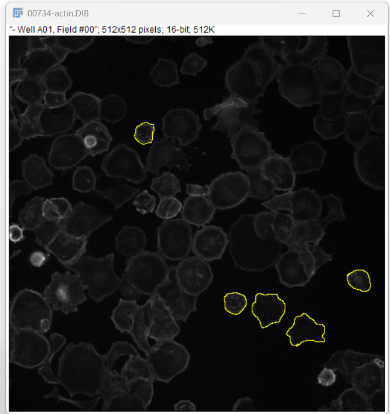
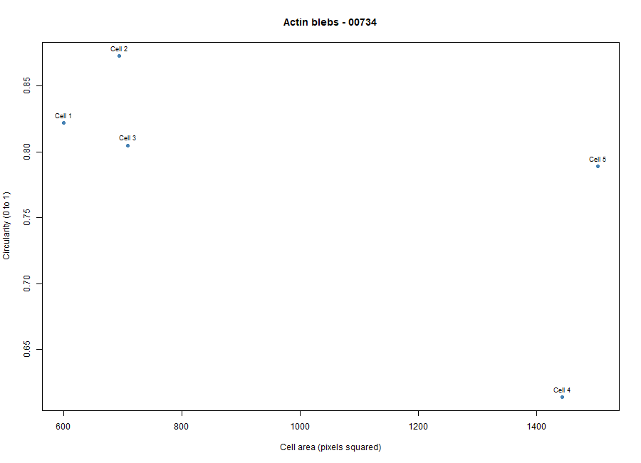
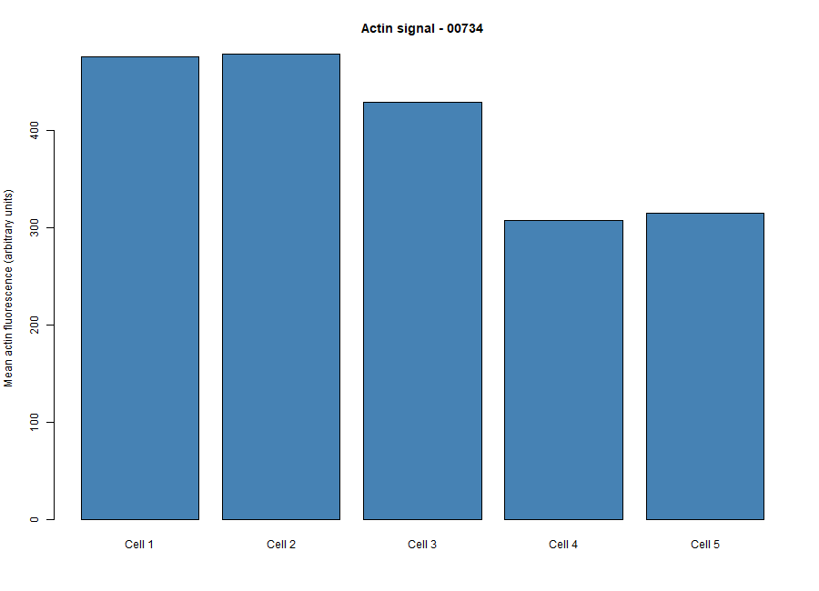

# Cytoskeleton and Cell Morphology — BBBC018

## Karp Chapter 9 Laboratory Activity

**Name:** Hobe Palopalo, BSBIO-III  
**Course/Section:** Cell and Molecular Biology - A  
**Dataset:** BBBC018v1 — HT29 Human Colon Cancer Cells  
**Selected Phenotype:** Actin blebs  
**Image Field ID:** 00734  
**Actin Image:** `00734-actin.DIB`  
**DNA Image:** `00734-DNA.DIB` 

## 1. Introduction

This laboratory activity examined cell morphology and the organization of the actin cytoskeleton using fluorescence microscopy images of HT29 human colon cancer cells from the Broad Bioimage Benchmark Collection (BBBC018).

The objective was to identify a cell phenotype, measure the morphology of five cells using Fiji/ImageJ, and analyze the results using RStudio.

## 2. Selected Phenotype: Actin Blebs

I selected **Actin blebs** for image field 00734 after comparing the actin fluorescence image with the reference phenotype image provided by BBBC018.

Several cells appeared rounded, with irregular cell boundaries and small protrusions along their edges. These observations are consistent with possible actin blebbing, which involves localized changes in the cell membrane and underlying actin cortex.

The classification is based on visual comparison of a fixed fluorescence image.

## 3. Methodology

1. Opened `00734-actin.DIB` and `00734-DNA.DIB` in Fiji/ImageJ.
2. Examined the actin staining pattern and cell morphology.
3. Selected five individual cells using the **Freehand Selection** tool.
4. Used Fiji to measure cell area, mean fluorescence intensity, circularity, and aspect ratio.
5. Saved the measurements to `data/fiji_results.csv`.
6. Processed the measurements using RStudio.
7. Generated a numerical summary and two graphs.
8. Saved the analysis outputs for documentation and submission.

## 4. Results

### Individual Cell Measurements

| Cell | Area (px²) | Mean Actin Intensity | Circularity | Aspect Ratio |
| --- | --- | --- | --- | --- |
| Cell 1 | 600 | 475.043 | 0.822 | 1.173 |
| Cell 2 | 694 | 478.718 | 0.873 | 1.035 |
| Cell 3 | 709 | 428.853 | 0.805 | 1.253 |
| Cell 4 | 1443 | 307.220 | 0.614 | 1.309 |
| Cell 5 | 1504 | 315.007 | 0.789 | 1.014 |

### Summary Statistics

| Measurement | Result |
| --- | --- |
| Number of cells measured | 5 |
| Mean cell area | 990 px² |
| Mean circularity | 0.7806 |
| Mean aspect ratio | 1.1568 |
| Mean actin fluorescence | 400.9682 arbitrary units |

The cells varied in size, circularity, and fluorescence intensity. Cell 2 had the highest circularity and actin fluorescence intensity, while Cell 4 had the lowest values for both measurements.

## 5. Figures

### Figure 1. Five Cells Measured in Fiji

*Five cells selected using freehand regions of interest (ROIs) in Fiji/ImageJ.*

### Figure 2. Cell Area vs. Circularity

*Scatter plot comparing cell area and circularity for the five measured cells.*

The plot shows that the measured cells have different sizes and shapes. Cell 4 was the least circular, indicating a more irregular outline.

### Figure 3. Mean Actin Fluorescence Intensity

*Bar graph showing the mean actin fluorescence intensity of each measured cell.*

Cells 1 and 2 had the highest mean actin fluorescence intensities, while Cells 4 and 5 had lower intensities.

## 6. Discussion Questions

### 1. Which specific phenotype did you choose, and what visible features support your choice?

I chose **Actin blebs** because several cells in image 00734 appeared rounded with uneven boundaries and small protrusions along their edges. These features were similar to those in the BBBC018 Actin blebs reference image.

### 2. Were your five cells mostly round or elongated?

My five measured cells were mostly rounded rather than strongly elongated. Their mean circularity was **0.7806**, and their mean aspect ratio was **1.1568**. Cell 4 showed the greatest irregularity based on its lower circularity value of **0.614**.

### 3. What role does actin play in maintaining cell shape and cell movement?

Actin is a major component of the cytoskeleton. It provides structural support, helps maintain cell shape, and contributes to changes in the cell membrane. Actin filament assembly and interactions with myosin help cells generate forces needed for movement and shape changes.

### 4. Why can't a single fixed fluorescence image show how fast a cell moves?

A fixed fluorescence image shows a cell at only one moment in time. To calculate movement speed, the cell's position must be measured at multiple time points. Therefore, a single fixed image can show cell morphology but cannot determine how fast a cell moves.

## 7. Conclusion

This laboratory activity demonstrated how Fiji/ImageJ and RStudio can be used to study cell morphology and actin fluorescence patterns.

The five cells measured from image field 00734 were generally rounded, with variations in area, circularity, and fluorescence intensity. Visual comparison with the BBBC018 reference images supported the selection of Actin blebs as the phenotype.

The results describe cell morphology and fluorescence intensity but do not directly measure cell movement.

## 8. Software Used

- **Fiji/ImageJ:** Cell selection and image measurements
- **RStudio:** Statistical analysis and data visualization
- **GitHub:** Repository documentation and submission

## 9. Dataset Credit

Image set **BBBC018v1** was obtained from the Broad Bioimage Benchmark Collection.

Dataset website: [bbbc.broadinstitute.org/BBBC018](https://bbbc.broadinstitute.org/BBBC018)

Ljosa et al., *Nature Methods* (2012).

The BBBC018 dataset is distributed under the Creative Commons Attribution-NonCommercial-ShareAlike 3.0 license.
